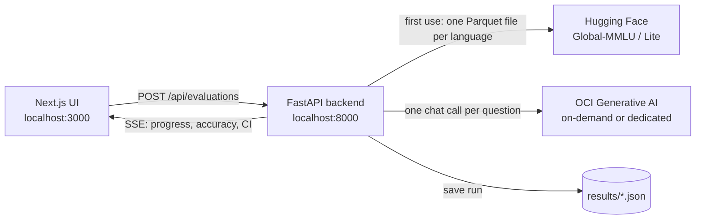

# Global-MMLU multilingual evaluation

**Does your LLM know as much in Albanian, Swahili, or Hindi as it does in
English?** Headline benchmark scores are usually measured in English. This
project lets you find out, language by language, on the models you actually
run on OCI Generative AI: on-demand models and your own dedicated AI clusters.

Pick a model, a language, and a number of questions in a local web UI. The
tool draws a reproducible random sample from
[Global-MMLU](https://huggingface.co/datasets/CohereLabs/Global-MMLU) or
[Global-MMLU-Lite](https://huggingface.co/datasets/CohereLabs/Global-MMLU-Lite)
by Cohere Labs, asks the model, and shows answers, accuracy, and its
confidence interval live, as they arrive.

## Why it is useful

* **Same questions, every language.** Global-MMLU translates the same MMLU
  questions into 42 languages, and Lite adds seven more (including Albanian,
  Hungarian, Slovak, and Welsh). The gap between a language and English is a
  direct measure of what a model loses outside English.
* **Culture-aware results.** Every question is tagged as culturally sensitive
  (CS) or culturally agnostic (CA), so you can tell "weaker in the language"
  apart from "weaker on regional knowledge".
* **Numbers you can trust.** Each run has an explicit seed (default 42): the
  same seed, dataset, language, and size always select the same questions, so
  models are compared on identical samples. Every accuracy comes with its 95%
  Wilson confidence interval, so a 3-point difference on 100 questions is not
  mistaken for a real one.
* **Your models, your tenancy.** Calls go through the OCI Generative AI
  inference API with your own OCI credentials, to on-demand models (OpenAI,
  Google, Meta, and others) or to dedicated AI cluster endpoints.
* **Reasoning under control.** Choose the reasoning effort per run and see
  its effect: reasoning models can burn their token budget thinking and never
  answer; the tool records it instead of hiding it.

## What you get

* **Live evaluation**: progress bar, running accuracy with a shaded confidence
  band, invalid answers and errors, latency, and a table of every answer.
* **Breakdowns** by subject category (STEM, Humanities, Medical, and more) and
  by cultural sensitivity, each with its interval.
* **Runs history**: every run is saved as JSON; the Runs page lists them with
  filters by model, dataset, language, and reasoning effort, and opens any run
  to its breakdowns and answers.
* **Safe by design**: Stop ends a run and keeps the partial results; a request
  the model rejects stops the run at the first error instead of wasting
  hundreds of calls; nothing is created in your tenancy.

## How it works



1. On first use of a language, the backend downloads only that language's
   test split (a few MB) and caches it in `data/cache/<dataset>/`.
2. It samples N questions with the given seed and sends each one to the model
   as a four-option multiple-choice prompt, a few calls in parallel.
3. It grades the first letter A–D in each reply and streams every result to
   the UI as a Server-Sent Event, with running accuracy and interval.
4. At the end (or on Stop) it saves the run, with summary and answers, to
   `results/`.

| Dataset | Languages | Test questions per language |
| --- | --- | --- |
| Global-MMLU | 42 | 14,327 |
| Global-MMLU-Lite | 23 (7 not in the full set: Albanian, Burmese, Hungarian, Odia, Slovak, Tajik, Welsh) | 400, balanced between CS and CA |

Repository layout:

* `backend/`: FastAPI service (Python 3.12): dataset cache, OCI calls, SSE
  streaming, runs history.
* `frontend/`: Next.js UI (evaluation and Runs pages).
* `specs/001-multilingual-evaluation.md`: scope, design decisions, API,
  acceptance criteria, and verification notes.
* `tests/`: unit tests (no network or credentials needed).

## Prerequisites

* Conda and Node.js 20 or later.
* An OCI config file (default `~/.oci/config`) with a profile whose user can
  call Generative AI inference in `eu-frankfurt-1`, for example through the
  policy `allow group <group> to use generative-ai-family in compartment <compartment>`.
* Internet access to `huggingface.co` and to the OCI inference endpoint.

## Setup

```bash
conda create -n global-mmlu python=3.12
conda activate global-mmlu
pip install -r requirements-dev.txt
cp .env.example .env            # then set OCI_PROFILE (and OCI_COMPARTMENT_ID if needed)
cd frontend && npm install && cp .env.example .env.local
```

Main settings in `.env`:

| Variable | Meaning | Default |
| --- | --- | --- |
| `OCI_PROFILE` | profile of the OCI config file (user principal) | `DEFAULT` |
| `OCI_REGION` | region of the inference endpoint | `eu-frankfurt-1` |
| `OCI_COMPARTMENT_ID` | compartment for the calls | profile tenancy |
| `MODELS`, `DEFAULT_MODEL` | models offered by the UI (see below) | `openai.gpt-5.6-luna` |
| `MAX_CONCURRENCY` | parallel calls per run | `4` |
| `DEFAULT_SEED` | seed pre-filled in the UI | `42` |
| `MAX_QUESTIONS` | upper bound per run | `500` |

`MODELS` is a comma-separated list. An entry is either an on-demand model ID,
or `label=target` to show a readable label in the UI. A target that is the
OCID of a dedicated AI cluster endpoint (`ocid1.generativeaiendpoint...`) is
called on that endpoint:

```
MODELS=openai.gpt-5.6-luna,my-gpt-oss=ocid1.generativeaiendpoint.oc1.eu-frankfurt-1.<id>
DEFAULT_MODEL=openai.gpt-5.6-luna
```

Restart the backend after changing `.env`. On-demand OpenAI models are sent
`max_completion_tokens`; other models and all dedicated endpoints get
`max_tokens` and `temperature=0`. Cohere models (`CohereChatRequest` format)
are not supported yet.

### Reasoning effort

The UI lets you choose the reasoning effort of a run: **Model default** (the
parameter is not sent) or `none`, `minimal`, `low`, `medium`, `high`. The
choice is saved with the results; use the same one when comparing models.

* Reasoning models can spend the whole `MAX_COMPLETION_TOKENS` budget on
  reasoning and return an empty answer, recorded as `invalid` with a latency
  close to the time needed to generate the budget. Lowering the effort (for
  example `none`) avoids it.
* Some models reject the parameter, for example `openai.gpt-4.1` for any value
  and some gpt-oss deployments for `none`. The run then stops at once with
  the service error; choose **Model default**. Others, such as Llama, ignore it.

## Run

In two terminals, from the repository root:

```bash
backend/start.sh
```

```bash
frontend/start.sh
```

Stop each server with `Ctrl+C`. `backend/start.sh --reload` restarts the
backend when Python code changes (edits to `.env` still need a manual
restart). Optional variables: `CONDA_ENV`, `HOST`, and `PORT` for the backend,
`PORT` for the UI (add a new UI origin to `CORS_ORIGINS`).

Open <http://localhost:3000>, choose model, reasoning effort, dataset,
language, and number of questions, and press **Start evaluation**. The seed is required and is
pre-filled with `DEFAULT_SEED` (42): the same seed, dataset, language, and
number of questions always select the same questions, so keep it fixed when
comparing models. **Stop** ends the run; results received so far are kept.

Accuracy is shown with its 95% Wilson confidence interval: in the
Accuracy tile, as a shaded band in the running chart, and for each
category in the breakdown (bar whiskers and text).

The **Runs** page (<http://localhost:3000/runs>) lists every result file in
`results/`, newest first, with accuracy, interval, invalid and error counts,
latency, and status. Filter by model, dataset, language, and reasoning effort;
click a run to see its breakdowns and answers. Stopped (partial) runs are
hidden unless **Show stopped runs** is checked; their files are kept. Runs
saved before the effort was recorded show "not recorded" (on-demand OpenAI
models then got `low`).

The first run of a language downloads its Parquet file (a few MB, less for
Lite) into `data/cache/<dataset>/`. Each run is saved as JSON in `results/`.
With Lite, 400 questions give a margin of error of about ±4–5 points (95%).

## API

```bash
curl -N -X POST http://localhost:8000/api/evaluations \
  -H 'Content-Type: application/json' \
  -d '{"model_id": "openai.gpt-5.6-luna", "dataset": "global-mmlu-lite", "language": "sq", "num_questions": 5, "seed": 42}'
```

`dataset` is `global-mmlu` (default) or `global-mmlu-lite`.

The response is an SSE stream of `status`, `start`, `result`, and `done`
events (see the specification). Other endpoints: `GET /api/models`,
`GET /api/datasets`, `GET /api/languages?dataset=...`, `GET /api/runs`,
`GET /api/runs/{run_id}`, `GET /api/health`.

## Checks

```bash
conda run -n global-mmlu black --check backend tests
conda run -n global-mmlu pylint backend/app tests
conda run -n global-mmlu pytest
npm --prefix frontend run lint
```

Unit tests use local fixtures and a fake model: no network or credentials.

## Limitations

* Global-MMLU inherits MMLU's known issues (some wrong or ambiguous
  questions, likely training-data contamination, scores near the ceiling for
  top models), and translation quality varies by language.
* Translated questions keep their mostly Western content: they measure
  understanding in a language, not local knowledge.
* The instruction of the prompt is in English; question and options are in
  the target language.
* Cohere chat models (`CohereChatRequest` format) and authentication methods
  other than the OCI user principal are not supported yet.

## Costs and cleanup

Each question is one inference call: billed per token on demand, or covered
by the hourly cost of an existing dedicated AI cluster. No OCI resources are
created. `data/` and `results/` are local and can be deleted.

## Troubleshooting

* **Cannot reach the backend** in the UI: start the backend, and check that
  `CORS_ORIGINS` includes the UI origin.
* **`OCI client setup failed`**: check `OCI_CONFIG_FILE` and `OCI_PROFILE`.
* **Every answer is `error`**: hover the cell to see the service error; a
  `404` usually means the model is not available in the region or compartment,
  `401`/`403` an authentication or policy problem.
